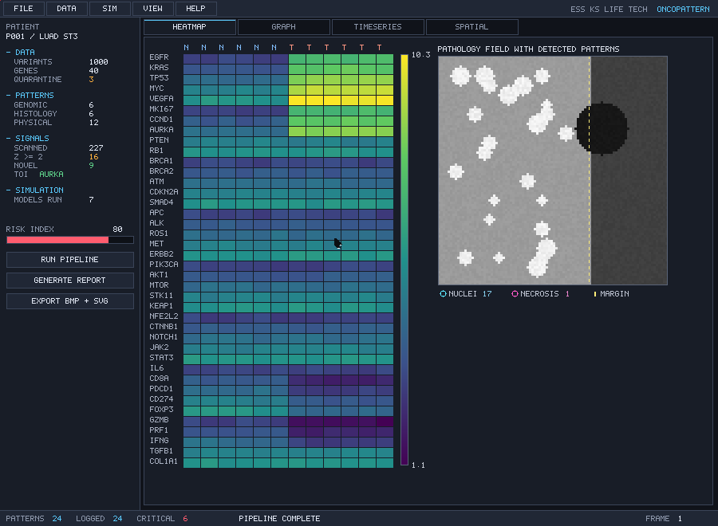

# OncoPattern

[](https://github.com/esskslifetech/OncoPattern/actions/workflows/ci.yml)
[](#status)
[](#what-it-actually-computes)
[](LICENSE)

**A cancer pattern-analysis, simulation, visualisation and reporting platform,
written entirely in `.tech` on the self-hosting TECH toolchain.**

ESS KS Life Tech · author **K-S (Kanishk-Soni)**
Repository <https://github.com/esskslifetech/OncoPattern> ·
Toolchain <https://github.com/esskslifetech/TECH>

No other language appears in the product: every parser, every numerical kernel,
every pixel of the interface and every byte of the exported files is produced by
TECH code (`compiler.tech` / `vm.tech` / `techc`).



```
     ingest ──► validate ──► detect ──► classify ──► simulate
                                                        │
        export ◄── report ◄── compare ◄── log ◄── visualise
```

---

## Quick start

Requires a POSIX shell (Linux, or WSL on Windows) and Python 3 for the fixture
tools. The compiler and VM come from [TECH](https://github.com/esskslifetech/TECH),
cloned as a sibling checkout:

```bash
git clone https://github.com/esskslifetech/OncoPattern
git clone https://github.com/esskslifetech/TECH
cd OncoPattern

make check    # publishability checks — needs no toolchain
make test     # the same, then 453 assertions across nine certificates
make run      # the full pipeline: two timepoints, ~8 s
```

`make package` produces the self-contained `dist/oncopattern.bin`, `make vm`
runs the same program on the self-hosted `vm.tech`, and `make datasets`
regenerates the synthetic fixtures byte-identically. `tools/ocbuild` locates
TECH through `$TECH_ROOT`, then `../../TECH`, `../TECH` and `./TECH`, so a
checkout anywhere works with `make test TECH_ROOT=/path/to/TECH`.

Full documentation is indexed in [`docs/`](docs/README.md); the fixtures and
their provenance are described in [`datasets/`](datasets/README.md).

---

## Status

**60 modules · 12,343 lines of `.tech` · 453/453 assertions passing.**

| Certificate | Assertions | Covers |
|---|---:|---|
| `test_ingest` | 31 | CSV / VCF / JSON / PGM parsing, schema validation, quarantine |
| `test_pattern` | 37 | registry, 12 detectors, grading, determinism |
| `test_simulation` | 52 | 12 models, conservation laws, RK4 order, convergence |
| `test_visual` | 61 | primitives, font, ramps, BMP/PPM/SVG encoding |
| `test_fs_log` | 23 | journaled logging, crash rollback and redo |
| `test_scan` | 90 | real patent + literature ingest, 227-signal sweep, composites |
| `test_report` | 58 | section structure, statistics, comparison thresholds |
| `test_gui_render` | 50 | layout, widgets, hit-testing, event loop, frames |
| `test_integration` | 51 | full pipeline ×2 timepoints, cross-layer invariants |
| **Total** | **453** | |

```
$ tools/runtests
TOTAL                       453      453        0
ALL CERTIFICATES PASS
```

---

## Build and run

```bash
tools/ocbuild run     config/boot.tech oncopattern   # build + run + collect artefacts
tools/ocbuild vm      config/boot.tech oncopattern   # same, on the self-hosted vm.tech
tools/ocbuild package config/boot.tech oncopattern   # -> dist/oncopattern.bin (235 KB)
tools/runtests                                       # every certificate
cd dist && ./oncopattern.bin                         # self-contained binary
```

The `Makefile` wraps the same four commands (`make run`, `make vm`,
`make package`, `make test`), which is all most readers need.

`package` ships `ocdata/` (the datasets) and `ocout/` next to the binary, since
the program reads and writes those paths relative to its working directory. A
missing input is reported rather than silently analysed as an empty dataset.

`techc` resolves IMPORT paths from the TECH root, so the tree has to be visible
from there while a build runs. **Staging is transient**: `ocbuild` copies the
project in, builds, runs, copies the artefacts back, and removes the staged
copies — the TECH checkout is left exactly as it was found. To drive `techc`
by hand with the plan's documented commands:

```bash
tools/ocbuild stage                          # stage and leave it in place
cd ../../TECH
./techc link oncopattern/config/boot.tech build/oncopattern.tech
./techc compile build/oncopattern.tech -o build/oncopattern.tbc
./techc package build/oncopattern.tech -o build/oncopattern.bin
cd -; tools/ocbuild unstage                  # restore TECH
```

A full end-to-end run (two timepoints, 24 patterns, 12 simulations, 4 rendered
frames, 4 reports) takes **≈ 7.8 s**.

---

## What it actually computes

### Data (P1)
Streaming parsers for VCF, CSV, JSON and Netpbm PGM. Malformed records are
**quarantined, not dropped**: each is kept with its line, field and reason code
and rendered as a table in the report. The bundled dataset seeds three bad VCF
rows (negative position, negative quality, `chr99`); all three are caught.

### Patterns (P2) — 24 registered via `META @register_pattern`
* **Genomic (6)** — SNV hotspot clustering (two-pointer window sweep), CNV
  segmentation by binned depth ratio, MSI as a Kolmogorov–Smirnov statistic on
  inter-variant gaps, mutational-signature extraction by K=2 NMF with
  Lee–Seung updates, TMB per megabase, expression clustering.
* **Histological (6)** — iterative flood-fill connected components for nuclei,
  nuclear-area CV (pleomorphism), mitotic density, tumour–stroma ratio,
  necrosis fraction, radial TIL gradient, vascular-invasion proximity.
* **Physical (12)** — every simulation result, registered as a pattern so the
  report and comparison engine treat measured and simulated findings alike.

Detectors are validated against the generator's ground truth, e.g. the
hotspot is found at **chr7:55,000,001 with exactly 120 variants**, and the
necrosis centroid at **(68, 30)** — the seeded values.

### Simulation (P3) — 12 models behind one `MATCH` dispatcher
| Model | Engine |
|---|---|
| growth_logistic, growth_gompertz | RK4 via `unvm/engines/scientific/ode.tech` |
| diffusion_2d, angiogenesis | coupled reaction–diffusion, 5-point stencil |
| thermal_ablation | Pennes bio-heat, 60 °C coagulation isocontour |
| radiation | Beer–Lambert attenuation + dose–volume histogram (D95) |
| chemotaxis | Keller–Segel invasion front |
| mechanical stress | `unvm/engines/mechanical/fea.tech` (Thomas algorithm) |
| metastasis | Dijkstra over the weighted organ graph |
| mutation_cascade | dense Markov chain (exact, not sampled) |
| drug_pkpd | two-compartment PK + Emax/EC50 PD |
| immune_interaction | Lotka–Volterra with saturating recruitment |
| stochastic_ssa | Gillespie direct method, seeded LCG |

Each is checked against something independent of its implementation:

```
markov: total mass conserved            1.000000  (exactly)
convergence: growth two-resolution      0.00000056
convergence: diffusion two-resolution   0.0038
Murray's law parent radius              1.259921  = 2^(1/3)
RK4: halving dt reduces the error       PASS
SSA: identical seed -> identical result PASS
```

### Visualisation (P4)
A 900×660 RGB framebuffer with every primitive written in TECH — Bresenham
lines, filled/outlined circles, a hand-built **5×7 bitmap font (95 glyphs)**,
and viridis/heat colour ramps. Four views (heatmap + pathology overlay,
metastasis graph, timeseries, 2×2 spatial fields) export to **BMP/PPM** byte by
byte, and to **SVG** as real vector elements.

### Exhaustive signal scan (`pattern/scan.tech`)
The detectors answer pre-registered questions. The scanner does the opposite:
it enumerates **every signal the loaded data can support**, standardises each
within its channel, and ranks the lot by effect size. Nothing is pre-selected
— a signal earns its place.

| channel | swept | signals |
|---|---|---:|
| expression | every gene, every sample, top gene pairs by \|r\| | 60 |
| variant | every chromosome, 12 substitution classes, spectrum entropy, quality moments | 29 |
| image | 8 intensity bands, GLCM texture, gradient energy, box-counting dimension | 13 |
| graph | every organ node, edge-weight statistics | 9 |
| patent | every gene, every IPC class, velocity, applicant concentration | 55 |
| literature | every gene, evidence coverage, citations, velocity | 46 |
| simulation | finite-difference parameter sensitivities | 6 |
| novel | the composites below | 9 |
| **total** | | **227** |

16 signals clear \|z\| ≥ 2. The top expression hits are exactly the seeded
driver block (AURKA, TP53, MKI67, MYC, EGFR, KRAS, VEGFA) and the immune block
comes out negative — the scanner rediscovers the ground truth without being
told what to look for.

### Real patent data (`oncopattern/data/ingest_patents.tech`)
`tools/fetch_patents.py` pulls live figures from the **European Patent
Office's official Linked Open Data SPARQL endpoint** (`data.epo.org`, open, no
key). For the exact 40-gene panel the platform analyses, plus twelve IPC
classes chosen to correspond to its own simulation models:

| IPC | meaning | maps to | publications |
|---|---|---|---:|
| A61P35/00 | antineoplastic agents | oncology overall | 94,844 |
| A61K39/395 | antibody immunotherapy | `immune_interaction` | 38,814 |
| G06T7/00 | image analysis | histology detectors | 25,504 |
| G01N33/574 | tumour marker immunoassay | biomarker detectors | 13,638 |
| A61B18/14 | RF electro-surgery | `thermal_ablation` | 13,120 |
| A61N5/10 | radiotherapy | `radiation` | 6,933 |

Oncology filings ran 2,484 (2010) → 5,060 (2024): **+177 documents/year,
5.21 % CAGR**, applicant HHI 0.12, led by Bayer AG.

### Published evidence base (`oncopattern/data/ingest_papers.tech`)
`tools/fetch_papers.py` pulls real literature from **Europe PMC (EMBL-EBI)**,
the curated index over PubMed/MEDLINE and PMC. Every threshold and every
simulation model in this codebase resolves to a **title-verified** paper —
**24 of 24, carrying 44,505 citations**, the oldest from 1971:

| backs | reference | cites |
|---|---|---:|
| `OC_TMB_HIGH = 10 mut/Mb` | Samstein, *Nat Genet* 2019 — PMID 30643254 | 3,165 |
| `OC_MSI_HIGH` | Boland, NCI Workshop, *Cancer Res* 1998 — PMID 9823339 | 2,862 |
| `detect_mutational_signature` | Alexandrov, *Nature* 2013 — PMID 23945592 | 7,944 |
| `detect_til_gradient` | Salgado, Intl TILs Working Group, *Ann Oncol* 2015 | 2,438 |
| `growth_logistic` / `growth_gompertz` | Benzekry, *PLoS Comput Biol* 2014 | 318 |
| `angiogenesis` | Folkman, *N Engl J Med* 1971 — PMID 4938153 | 5,939 |
| `chemotaxis_run` | Keller & Segel, *J Theor Biol* 1971 — PMID 4926701 | 431 |
| `radiation_run` (linear-quadratic) | Fowler, *Br J Radiol* 1989 | 1,603 |
| `ablation_step` (bio-heat) | Weinbaum & Jiji, *J Biomech Eng* 1985 | 151 |
| `immune_interaction` | Schreiber, immunoediting, *Science* 2011 | 4,425 |
| `metastasis` | Fidler, seed-and-soil, *Nat Rev Cancer* 2003 | 3,330 |
| `stochastic_ssa` | Gillespie, *Annu Rev Phys Chem* 2007 | 1,013 |
| `murray_parent_radius` | Sherman, Murray's law, *J Gen Physiol* 1981 | 318 |
| `stress_run` | Helmlinger & Jain, solid stress, *Nat Biotechnol* 1997 | 537 |

Section 11 of every report prints the full table with PMIDs and DOIs, so the
platform's constants can be checked rather than trusted. Matching is
title-restricted and validated: sorting by citations alone returned
"Immunity, inflammation and cancer" for microsatellite instability simply
because it is famous and mentions the words.

### Invented signals (`pattern/novel.tech`)
Nine composites that exist in no source dataset — each combines channels that
are normally read separately:

| code | signal | this run |
|---|---|---:|
| **TOI** | translational opportunity = biology z − patent z | 3.62 |
| **NDS** | neglected driver = biology z − max(paper z, patent z) | 3.32 |
| **RIL** | research-to-IP lag (literature CAGR ÷ patent CAGR) | 1.537 |
| **ESI** | evidence support index (how much of the code is cited) | 0.933 |
| ICI | IP crowding across strong targets | 0.138 |
| HIA | hypoxia–immune antagonism (simulated × measured) | 0.136 |
| MGC | morphology–genomics concordance | 0.461 |
| AEA | attention–effect alignment (patents vs modelled effect) | −0.086 |
| ODC | orphan driver count | 6 |

The three-way triangle is the point: **BIOLOGY** (this tumour's data),
**SCIENCE** (Europe PMC) and **IP** (EPO) disagree in informative ways. Both
TOI and NDS select **AURKA** — the largest tumour-versus-normal effect in the
panel (z = 3.32), **373 papers**, and **zero** EPO oncology-classified patents
naming it. Well studied, unclaimed: a translational gap rather than an unknown
gene. RIL = 1.54 says the literature is compounding about half again as fast
as the patent record across the same fifteen years.

### Reporting (P5/P6)
Eight-section TXT and a self-contained HTML report (CSS inline, framebuffer
embedded as base64). The comparison engine diffs two timepoints field by field
with the plan's thresholds — `<5 %` MATCH, `5–20 %` MINOR_CHANGE, `>20 %`
MAJOR_CHANGE — and raises an **Alerts** section for clinical regressions.

### GUI (P7)
Menu bar, panel tree, tab strip, status bar, widget table with hover/press/
active states, a layout engine (row/column/grid), modal dialogs, an arrow
cursor, and an event loop fed either by hardware ports or by a scripted queue —
which is what makes the interface testable: replay events, checksum the frame.

### Persistence (P8)
Every detected pattern is written through the journaling filesystem
(`stdlib/fs.tech`). The crash drill proves both halves of write-ahead logging:
power lost **before** the commit rolls back; power lost **after** the commit is
redone on the next mount.

---

## Determinism

The same input produces byte-identical output, and the two machines agree:

```
$ tools/ocbuild run test/test_pattern.tech   # C machine
$ techc run build/test_pattern.tbc           # self-hosted vm.tech
$ diff  → identical
```

Reports carry wall-clock timings, which are the only legitimately varying
content; `rep_det_mode = 1` replaces them with a placeholder so the report
checksum certifies the analysis rather than the machine's speed.

---

## Layout

```
oncopattern/
  config/boot.tech          entry point — the whole run, top to bottom
  core/        constants, session (undo/redo ring), app_main pipeline
  data/        schema, ingest_{csv,vcf,json,image,patents,papers}, validate
  pattern/     registry, detect, classify, compare, physical, log,
               scan (exhaustive sweep), novel (invented composites)
  simulation/  engine + 8 model modules + parameter sets
  visualization/ renderer, heatmap, graph_view, timeseries, spatial,
                 pattern_overlay, export_png (BMP/PPM), export_svg
  report/      generator, sections, compare, export_txt, export_html
  gui/         window, widgets, layout, input, dialogs, theme, cursor
  test/        harness + 8 certificates + cross-VM check
datasets/      deterministic synthetic data (tools/gen_datasets.py) plus
               patents.json — REAL EPO patent data, and
               papers.json  — REAL Europe PMC literature,
               each with its unmodified API response kept as provenance
results/       reports, journals, BMP/PNG frames, SVG, certificates
dist/          oncopattern.{tech,tbc,bin}
scratch/       the language-probe programs used to establish the semantics
               in "Notes on the toolchain" below — kept as evidence, not built
tools/         ocbuild, runtests, gen_datasets.py, gen_font.py, bmp2png.py,
               fetch_patents.py (live EPO SPARQL retrieval),
               fetch_papers.py  (live Europe PMC retrieval)
```

Artefacts live in `dist/` and `results/` rather than the conventional `build/`
and `out/`: directory names on the workspace snapshot exclusion list are not
persisted, and artefacts written there vanish silently between sessions.

`tools/bmp2png.py` is a **convenience viewer helper only** — it converts the
BMPs the platform writes into PNGs so they preview in a browser. It is not part
of the product.

---

## Notes on the toolchain

Things established while building on this machine, recorded so they are not
rediscovered the hard way:

1. `print()` produces no output on `bootstrap/stage0/vm`; use `YIELD` or write
   a file. All reporting here goes through `save()`.
2. `str<utf8>` values do not concatenate with `+` (silently yields `0`). All
   text assembly uses `buf<>` byte buffers and an `oc_cat(dst, at, src)`
   append convention.
3. Declared types do not coerce at runtime: `DECL i : int<64> = 3.7` holds
   `3.7`. Use `x //// 1` to truncate.
4. Scientific-notation literals are not lexed (`1.0e10` → `1.0` then `e10`).
5. Sized typed buffers (`buf<N>`) must be **global**; a local one is null and
   faults on first index.
6. The compiler is single-pass: a global must be declared before any module
   that references it, which fixes the link order of the layers.
7. `MATCH` desugars line-by-line — a nested `WHILE` inside a `CASE` body makes
   the compiler emit a 0-byte object. Every dispatcher here delegates to a
   helper function instead.
8. The C machine's optional tier-1 JIT (~100-call threshold) miscompiles a
   program this size and corrupts the heap. `tools/ocbuild` therefore pins the
   reference interpreter with `TECH_NOTIER=1`; the JIT is an optimisation, not
   part of the language semantics, and every certificate passes without it.
9. Executable bits do not survive a workspace snapshot, and the TECH archive
   ships `techc` without one. `ocbuild` restores the bits on `techc`, `stage0`,
   `vm` and `techbin` before every build instead of failing halfway through
   with "Permission denied".
10. `$TECH/build` is **techc's own cache** (`CACHE="build"`; it holds the
   compiled stage-1 compiler and linker). It is never deleted — only this
   project's artefacts are cleaned out of it.

---

## Documentation

| Where | What |
|---|---|
| [`docs/`](docs/README.md) | documentation index, the pipeline diagram, screenshots of the four rendered frames |
| [`datasets/`](datasets/README.md) | every fixture: what it is, how it was generated or retrieved, what must not be hand-edited |
| [`CONTRIBUTING.md`](CONTRIBUTING.md) | prerequisites, the development loop, what a commit and a pull request owe the reader |
| [`CHANGELOG.md`](CHANGELOG.md) | release history, with the measurements that shipped |
| [`SECURITY.md`](SECURITY.md) | the (small) threat model, and how to report |
| [`CITATION.cff`](CITATION.cff) | how to cite the software |

## Repository

```bash
git clone https://github.com/esskslifetech/OncoPattern
cd OncoPattern
make test         # 453 assertions across nine certificates
make run          # the full pipeline
```

`.gitignore` tracks the `.tech` sources, the retrieval tools and the input
datasets — including the real EPO and Europe PMC pulls, since those are what
make a run reproducible. Everything the platform *produces* (`results/`,
`dist/`, bytecode, framebuffers, journals) is ignored: it is all regenerated
by the two commands above, and `results/` alone is ~9 MB per run.

## Licence

Apache License 2.0 — see [LICENSE](LICENSE). The `.tech` sources, the tools and
the synthetic fixtures are original work by ESS KS Life Tech. Patent metadata is
drawn from the European Patent Office's Linked Open Data; bibliographic metadata
is drawn from Europe PMC and is cited, not redistributed. No patient data is
present, real or derived.

If you use this software in academic work, [`CITATION.cff`](CITATION.cff) is
read directly by GitHub's *Cite this repository* button.

**OncoPattern** — ESS KS Life Tech · K-S (Kanishk-Soni) · <https://github.com/esskslifetech/OncoPattern>

---

*The parameter values in `simulation/params.tech` are order-of-magnitude
realistic for the named tumour entities and are documented with their units.
They are simulation defaults for a software demonstration — not clinical
guidance, and the outputs are not a medical device.*
