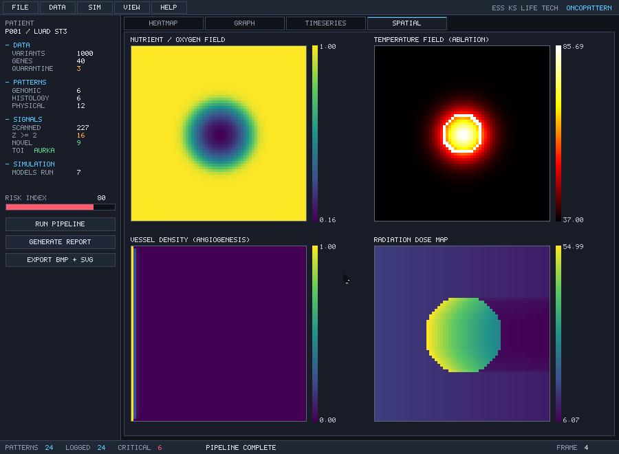
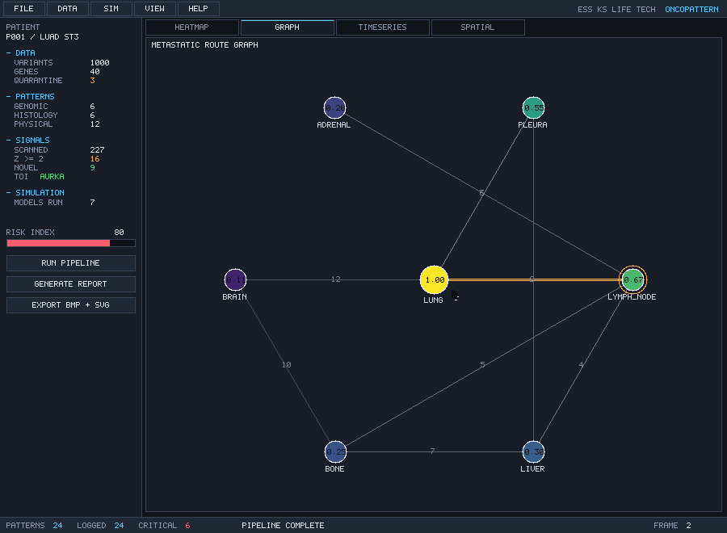
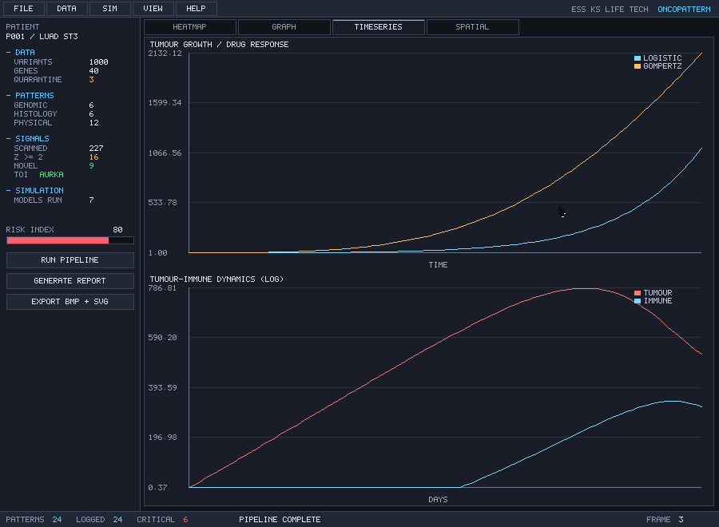

# Documentation index

The [README](../README.md) is the front door and the source of truth: what the
platform computes, how to build it, the measured status, and the toolchain
behaviour you have to know before writing `.tech`. Everything else here either
expands one of its sections or is a picture of the result.

| Document | Contents |
|---|---|
| [README](../README.md) | what it is, build and run, the nine layers, determinism, layout, toolchain notes |
| [datasets/README](../datasets/README.md) | every fixture, how it was generated or retrieved, and what must not be hand-edited |
| [CONTRIBUTING](../CONTRIBUTING.md) | prerequisites, the development loop, commit and review expectations |
| [CHANGELOG](../CHANGELOG.md) | release history with the measurements that shipped |
| [SECURITY](../SECURITY.md) | threat model (small) and how to report |
| [CODE_OF_CONDUCT](../CODE_OF_CONDUCT.md) | the short version |
| [CITATION](../CITATION.cff) | how to cite the software |
| [AUTHORS](../AUTHORS) | author, company, and the external data sources used at run time |

## The pipeline

```
     ingest ──► validate ──► detect ──► classify ──► simulate
                                                        │
        export ◄── report ◄── compare ◄── log ◄── visualise
```

Each stage is a directory under `oncopattern/`, and each has a certificate in
`oncopattern/test/` that asserts it independently of the others. The entry
point, `oncopattern/config/boot.tech`, runs the whole thing top to bottom, so
the order above is literally the order of the calls.

## Screenshots

Four frames rendered by the platform itself — every pixel written by `.tech`
through the framebuffer in `oncopattern/visualization/`, then exported as BMP
and converted for preview.

| | |
|---|---|
|  |  |
| Expression heatmap with the pathology overlay | Four spatial fields, including the ablated region |
|  |  |
| Metastasis reach over the weighted organ graph | Simulation timeseries against the measured baseline |

The GUI is not a mock-up: the menu bar, panels, tabs, status bar and widgets are
drawn by the same renderer that produced these frames, and the event loop can be
fed a scripted queue, which is what makes a frame replayable and a checksum
assertable.

## Where the numbers come from

Every figure quoted in the README is produced by a command in it:

| Figure | Produced by |
|---|---|
| certificate totals (per module, and the sum) | `tools/runtests` |
| pattern counts, hotspot locus, necrosis centroid | `oncopattern/test/test_pattern.tech` |
| conservation, convergence order, SSA determinism | `oncopattern/test/test_simulation.tech` |
| signal sweep totals and effect sizes | `oncopattern/test/test_scan.tech` |
| report structure and comparison thresholds | `oncopattern/test/test_report.tech` |
| end-to-end figures, alert counts | `oncopattern/test/test_integration.tech` |
| one full run's headline numbers | `results/run_summary.txt` |

If a number in the README cannot be reproduced by one of those, it is a defect
in the README.
